<div align="center">

# 🌬️ Respira SP

### Qualidade do ar para todo o estado de São Paulo com satélite, machine learning e um agente de IA que entende a legislação ambiental

[](#-como-rodar)
[](#-módulo-1--pm25-onde-não-existe-estação)
[](#-módulo-2--agente-de-normas-ambientais)
[-1baf7a)](#-módulo-2--agente-de-normas-ambientais)
[](tests/)
[](#-docker)

**[📊 Abrir o dashboard interativo](https://lucasbetioli123.github.io/respira-sp/)** · **[🔬 Detalhes técnicos](docs/DETALHES_TECNICOS.md)** · **[📓 Notebooks](notebooks/)**

<a href="https://lucasbetioli123.github.io/respira-sp/">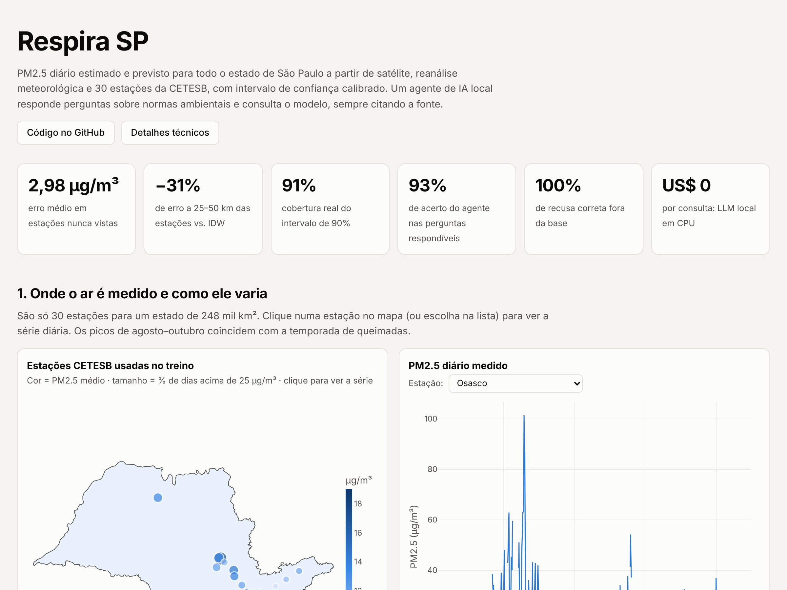</a>

</div>

---

## 💡 A ideia em 30 segundos

O **PM2.5** (partículas finas com menos de 2,5 µm) é o poluente do ar mais associado a doenças respiratórias e cardiovasculares. Mas o estado de São Paulo, com **645 municípios**, tem só algumas dezenas de estações que medem PM2.5, quase todas concentradas na Grande São Paulo. **Para a maior parte do estado, simplesmente não existe medição.**

O Respira SP resolve isso em duas frentes:

| | Módulo | Pergunta que responde |
|---|---|---|
| 🛰️ | **Estimativa e previsão de PM2.5** | *"Qual o PM2.5 hoje (e amanhã) em qualquer ponto do estado, com que margem de erro?"* |
| 🤖 | **Agente RAG de normas ambientais** | *"Esse valor ultrapassa o padrão legal vigente naquela data? Qual artigo diz isso?"* |

Os dois se conectam: o agente **chama o modelo de PM2.5 como ferramenta**, busca o trecho exato da resolução CONAMA, compara com o padrão vigente na data e **cita cada número**. Se a resposta não está na base, ele **recusa** em vez de inventar.

## 🧭 Arquitetura

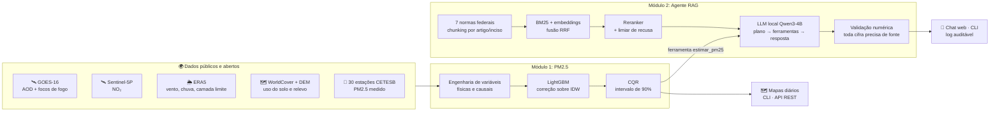

---

## 🛰️ Módulo 1 · PM2.5 onde não existe estação

**Como funciona:** a interpolação espacial (IDW) entre estações já é um baseline forte, então o modelo não tenta prever PM2.5 do zero. Ele aprende a **correção local** sobre o IDW (`log(PM2.5) − log(IDW)`) usando sinais físicos:

- **AOD / altura da camada limite**: aproxima a relação entre aerossol na coluna atmosférica e concentração na superfície
- **Correção higroscópica** `AOD × (1−UR)^0,6`: partículas incham com umidade e enganam o satélite
- **Fogo a favor do vento**: focos num raio de 150/400 km, ponderados pela direção do vento e pela potência radiativa (FRP)
- **Ventilação** (camada limite × vento), chuva, NO₂, urbanização, vegetação e relevo

### ✅ Validação feita do jeito difícil

Validação aleatória infla os números (aqui, R² de 0,84 contra 0,73 na validação honesta). Por isso:

- **Estação nunca vista:** cada grupo de estações sai inteiro do treino *e* das referências do IDW durante o teste
- **Período posterior:** treino no passado, teste no futuro (dois folds temporais, incluindo a seca/fumaça de 2021)
- **Sem vazamento de futuro:** a previsão D+1 usa só dados disponíveis ao fim do dia D. Um teste automatizado remove todas as observações futuras e confirma que as variáveis não mudam

### 📈 Resultados

| Métrica | Resultado |
|---|---|
| Erro médio (MAE) em estações nunca vistas | **2,98 µg/m³** (R² 0,73) |
| Redução de erro vs. IDW a **25–50 km** das estações | **−31%** (3,51 → 2,42 µg/m³) |
| Cobertura real do intervalo de 90% (CQR) | **90,6%** |
| Previsão D+1 vs. persistência ("amanhã = hoje") | **−6%** de erro com estação · **−9%** sem estação |
| Detecção de dias poluídos (> 25 µg/m³) usando o limite superior do IC como alerta | **94%** |

O ganho aparece exatamente onde um mapa é útil, **longe das estações**:

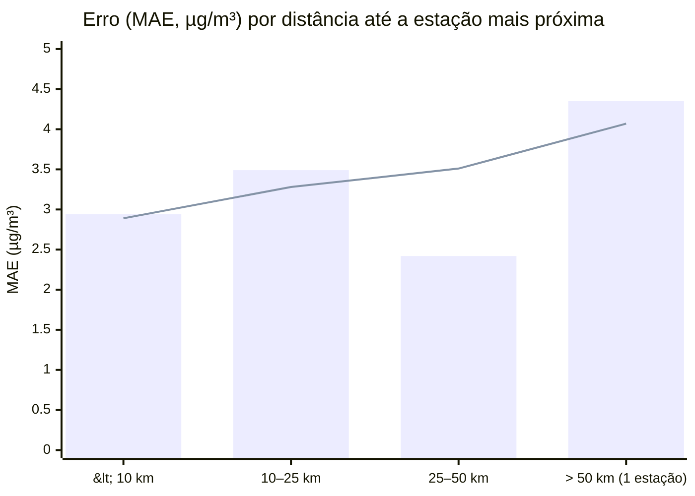
<sub>Barras = LightGBM com satélite · linha = IDW (interpolação clássica). Perto das estações o IDW já é difícil de bater; a 25–50 km o modelo erra 31% menos.</sub>

<details>
<summary><b>🔍 Leitura honesta: onde o modelo ainda erra</b></summary>

<br>

90% dos dias de teste estão na faixa "Boa" do IQAr, então prever sempre "Boa" já acerta 90%. Por isso as métricas também incluem acurácia balanceada e detecção de dias poluídos.

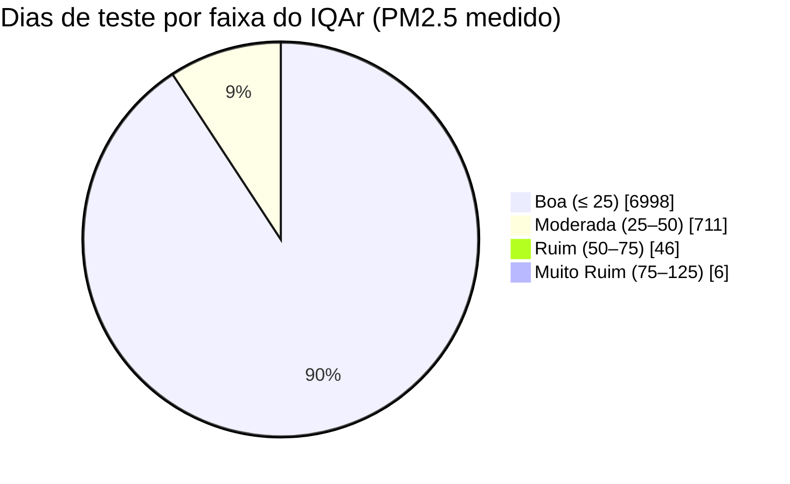

Árvores de decisão **suavizam os picos**: sozinho, o ponto central detecta 62% dos dias acima de 25 µg/m³, contra 79% do IDW. A solução foi usar a incerteza: o alerta pelo **limite superior do intervalo de 90%**, com regra fixa e sem ajuste no teste, detecta **94%** desses dias. O intervalo carrega a informação de risco que o ponto central perde.

Todos os números estão em [`docs/DETALHES_TECNICOS.md`](docs/DETALHES_TECNICOS.md) e são gerados a partir dos CSVs em `reports/metrics/`.
</details>

### 🗺️ Mapas de estimativa + incerteza

Dia de fumaça de queimadas (24/08/2021), previsão emitida na véspera. À direita, a largura do intervalo: a incerteza cresce longe das estações e nos episódios de fumaça.

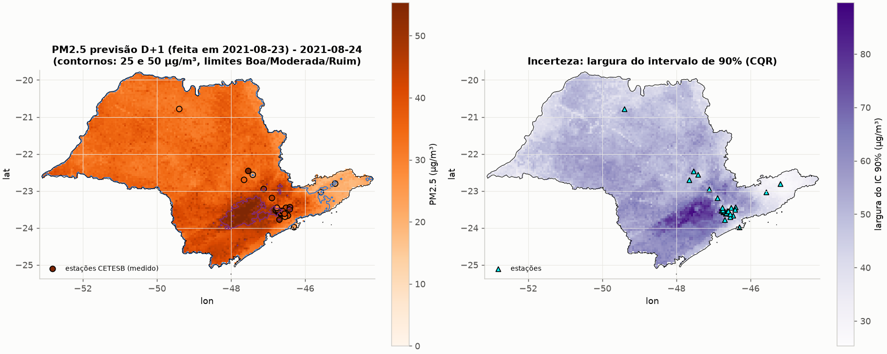

<details>
<summary><b>🖼️ Mais figuras (benchmark, SHAP, intervalos, episódios)</b></summary>

| | |
|---|---|
| 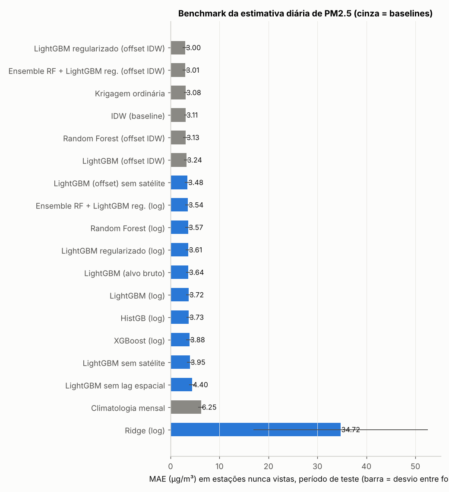 | 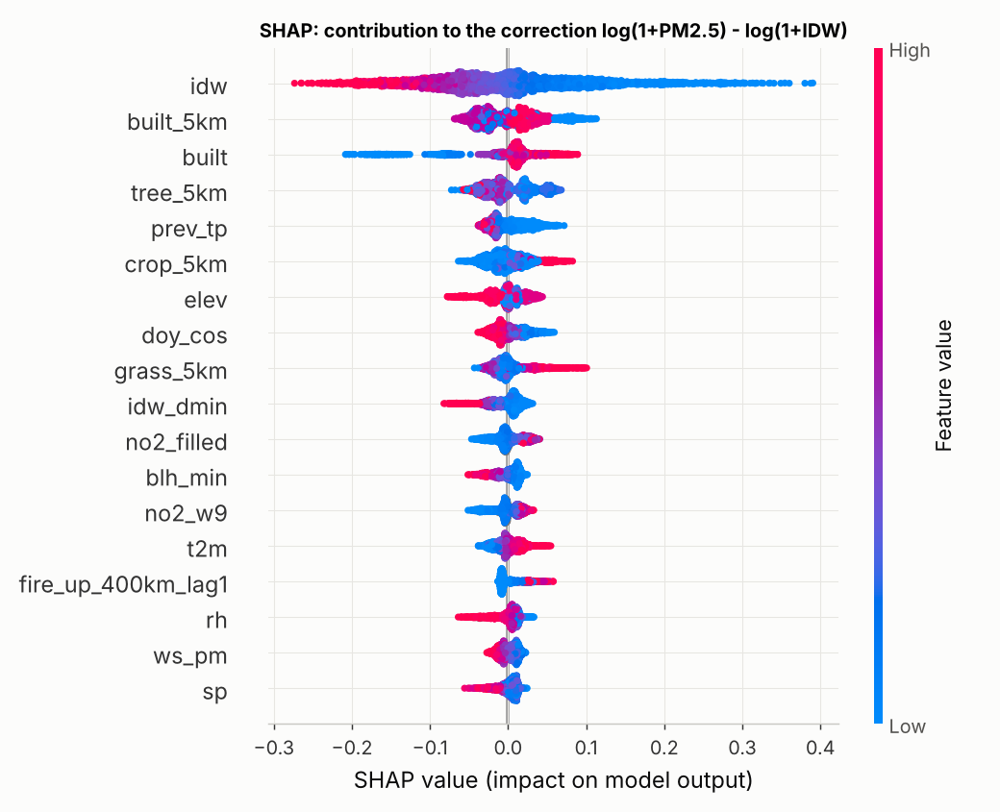 |
| **Benchmark de 25 modelos**: baselines, árvores, redes neurais, krigagem | **SHAP**: o que mais pesa na correção sobre o IDW |
| 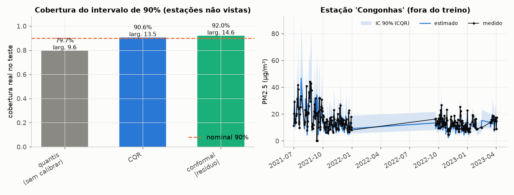 | 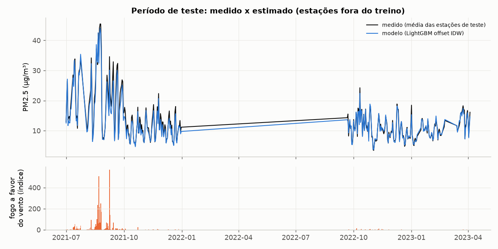 |
| **Intervalos**: quantis brutos × CQR × conformal | **Episódios de fumaça**: onde o modelo erra e por quê |
| 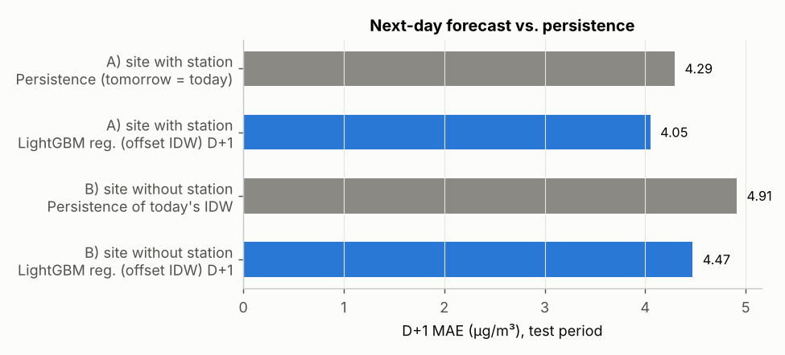 | 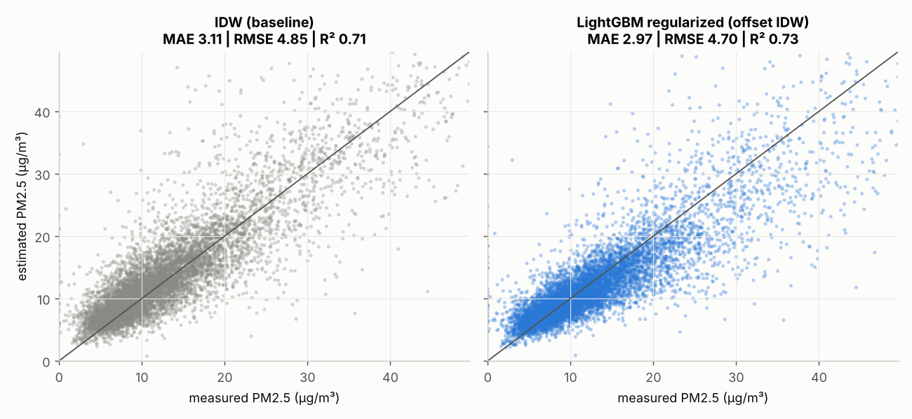 |
| **Previsão D+1** × persistência | **Dispersão**: IDW × modelo |

</details>

### 📍 As 30 estações de referência (mapa interativo)

O GitHub mostra o mapa abaixo como um mapa navegável: clique numa estação para ver a média, o máximo e a fração de dias acima de 25 µg/m³. Laranja = média ≥ 15 µg/m³.

```geojson
{"type":"FeatureCollection","features":[
{"type":"Feature","geometry":{"type":"Point","coordinates":[-46.7921,-23.5267]},"properties":{"estação":"Osasco","dias com PM2.5":410,"PM2.5 médio (µg/m³)":19.0,"máximo diário (µg/m³)":101.4,"dias acima de 25 µg/m³":"18%","marker-color":"#d95926","marker-size":"medium"}},
{"type":"Feature","geometry":{"type":"Point","coordinates":[-47.5363,-22.46]},"properties":{"estação":"Santa Gertrudes","dias com PM2.5":346,"PM2.5 médio (µg/m³)":17.2,"máximo diário (µg/m³)":66.6,"dias acima de 25 µg/m³":"18%","marker-color":"#d95926","marker-size":"medium"}},
{"type":"Feature","geometry":{"type":"Point","coordinates":[-46.7433,-23.5187]},"properties":{"estação":"Marg.Tietê-Pte Remédios","dias com PM2.5":512,"PM2.5 médio (µg/m³)":16.8,"máximo diário (µg/m³)":80.4,"dias acima de 25 µg/m³":"12%","marker-color":"#d95926","marker-size":"medium"}},
{"type":"Feature","geometry":{"type":"Point","coordinates":[-46.702,-23.5615]},"properties":{"estação":"Pinheiros","dias com PM2.5":266,"PM2.5 médio (µg/m³)":15.5,"máximo diário (µg/m³)":59.4,"dias acima de 25 µg/m³":"15%","marker-color":"#d95926","marker-size":"medium"}},
{"type":"Feature","geometry":{"type":"Point","coordinates":[-46.6607,-23.5918]},"properties":{"estação":"Ibirapuera","dias com PM2.5":329,"PM2.5 médio (µg/m³)":15.4,"máximo diário (µg/m³)":56.3,"dias acima de 25 µg/m³":"14%","marker-color":"#d95926","marker-size":"medium"}},
{"type":"Feature","geometry":{"type":"Point","coordinates":[-46.6635,-23.6163]},"properties":{"estação":"Congonhas","dias com PM2.5":432,"PM2.5 médio (µg/m³)":15.1,"máximo diário (µg/m³)":44.1,"dias acima de 25 µg/m³":"8%","marker-color":"#d95926","marker-size":"small"}},
{"type":"Feature","geometry":{"type":"Point","coordinates":[-46.629,-23.506]},"properties":{"estação":"Santana","dias com PM2.5":389,"PM2.5 médio (µg/m³)":14.6,"máximo diário (µg/m³)":51.7,"dias acima de 25 µg/m³":"11%","marker-color":"#2a78d6","marker-size":"medium"}},
{"type":"Feature","geometry":{"type":"Point","coordinates":[-46.6277,-23.5448]},"properties":{"estação":"Parque D.Pedro II","dias com PM2.5":432,"PM2.5 médio (µg/m³)":14.5,"máximo diário (µg/m³)":51.6,"dias acima de 25 µg/m³":"10%","marker-color":"#2a78d6","marker-size":"small"}},
{"type":"Feature","geometry":{"type":"Point","coordinates":[-47.139,-22.7802]},"properties":{"estação":"Paulínia-Sta Terezinha","dias com PM2.5":276,"PM2.5 médio (µg/m³)":14.4,"máximo diário (µg/m³)":61.2,"dias acima de 25 µg/m³":"9%","marker-color":"#2a78d6","marker-size":"small"}},
{"type":"Feature","geometry":{"type":"Point","coordinates":[-46.5185,-23.4555]},"properties":{"estação":"Guarulhos-Paço Municipal","dias com PM2.5":405,"PM2.5 médio (µg/m³)":14.2,"máximo diário (µg/m³)":44.5,"dias acima de 25 µg/m³":"8%","marker-color":"#2a78d6","marker-size":"small"}},
{"type":"Feature","geometry":{"type":"Point","coordinates":[-46.4207,-23.5015]},"properties":{"estação":"Itaim Paulista","dias com PM2.5":517,"PM2.5 médio (µg/m³)":14.0,"máximo diário (µg/m³)":55.1,"dias acima de 25 µg/m³":"10%","marker-color":"#2a78d6","marker-size":"medium"}},
{"type":"Feature","geometry":{"type":"Point","coordinates":[-47.1193,-22.9467]},"properties":{"estação":"Campinas-V.União","dias com PM2.5":352,"PM2.5 médio (µg/m³)":13.8,"máximo diário (µg/m³)":49.2,"dias acima de 25 µg/m³":"8%","marker-color":"#2a78d6","marker-size":"small"}},
{"type":"Feature","geometry":{"type":"Point","coordinates":[-46.7561,-23.4132]},"properties":{"estação":"Perus","dias com PM2.5":270,"PM2.5 médio (µg/m³)":13.8,"máximo diário (µg/m³)":41.2,"dias acima de 25 µg/m³":"7%","marker-color":"#2a78d6","marker-size":"small"}},
{"type":"Feature","geometry":{"type":"Point","coordinates":[-46.4099,-23.4401]},"properties":{"estação":"Guarulhos-Pimentas","dias com PM2.5":430,"PM2.5 médio (µg/m³)":13.8,"máximo diário (µg/m³)":66.8,"dias acima de 25 µg/m³":"10%","marker-color":"#2a78d6","marker-size":"medium"}},
{"type":"Feature","geometry":{"type":"Point","coordinates":[-46.5564,-23.6184]},"properties":{"estação":"São Caetano do Sul","dias com PM2.5":409,"PM2.5 médio (µg/m³)":13.7,"máximo diário (µg/m³)":44.6,"dias acima de 25 µg/m³":"9%","marker-color":"#2a78d6","marker-size":"small"}},
{"type":"Feature","geometry":{"type":"Point","coordinates":[-47.5815,-22.439]},"properties":{"estação":"Rio Claro-Jd.Guanabara","dias com PM2.5":355,"PM2.5 médio (µg/m³)":13.5,"máximo diário (µg/m³)":53.5,"dias acima de 25 µg/m³":"10%","marker-color":"#2a78d6","marker-size":"medium"}},
{"type":"Feature","geometry":{"type":"Point","coordinates":[-46.6004,-23.5497]},"properties":{"estação":"Mooca","dias com PM2.5":349,"PM2.5 médio (µg/m³)":13.4,"máximo diário (µg/m³)":44.7,"dias acima de 25 µg/m³":"7%","marker-color":"#2a78d6","marker-size":"small"}},
{"type":"Feature","geometry":{"type":"Point","coordinates":[-49.3983,-20.7847]},"properties":{"estação":"São José do Rio Preto","dias com PM2.5":301,"PM2.5 médio (µg/m³)":13.4,"máximo diário (µg/m³)":91.9,"dias acima de 25 µg/m³":"9%","marker-color":"#2a78d6","marker-size":"small"}},
{"type":"Feature","geometry":{"type":"Point","coordinates":[-46.5462,-23.6987]},"properties":{"estação":"S.Bernardo-Centro","dias com PM2.5":419,"PM2.5 médio (µg/m³)":12.9,"máximo diário (µg/m³)":40.8,"dias acima de 25 µg/m³":"7%","marker-color":"#2a78d6","marker-size":"small"}},
{"type":"Feature","geometry":{"type":"Point","coordinates":[-46.697,-23.7763]},"properties":{"estação":"Grajaú-Parelheiros","dias com PM2.5":400,"PM2.5 médio (µg/m³)":12.8,"máximo diário (µg/m³)":55.9,"dias acima de 25 µg/m³":"10%","marker-color":"#2a78d6","marker-size":"medium"}},
{"type":"Feature","geometry":{"type":"Point","coordinates":[-46.7374,-23.5663]},"properties":{"estação":"Cid.Universitária-USP-Ipen","dias com PM2.5":384,"PM2.5 médio (µg/m³)":12.5,"máximo diário (µg/m³)":62.2,"dias acima de 25 µg/m³":"7%","marker-color":"#2a78d6","marker-size":"small"}},
{"type":"Feature","geometry":{"type":"Point","coordinates":[-46.466,-23.6685]},"properties":{"estação":"Mauá","dias com PM2.5":377,"PM2.5 médio (µg/m³)":12.5,"máximo diário (µg/m³)":49.3,"dias acima de 25 µg/m³":"7%","marker-color":"#2a78d6","marker-size":"small"}},
{"type":"Feature","geometry":{"type":"Point","coordinates":[-47.6497,-22.7012]},"properties":{"estação":"Piracicaba","dias com PM2.5":381,"PM2.5 médio (µg/m³)":11.9,"máximo diário (µg/m³)":57.9,"dias acima de 25 µg/m³":"7%","marker-color":"#2a78d6","marker-size":"small"}},
{"type":"Feature","geometry":{"type":"Point","coordinates":[-46.8971,-23.192]},"properties":{"estação":"Jundiaí","dias com PM2.5":582,"PM2.5 médio (µg/m³)":11.7,"máximo diário (µg/m³)":53.9,"dias acima de 25 µg/m³":"5%","marker-color":"#2a78d6","marker-size":"small"}},
{"type":"Feature","geometry":{"type":"Point","coordinates":[-45.1911,-22.8019]},"properties":{"estação":"Guaratinguetá","dias com PM2.5":446,"PM2.5 médio (µg/m³)":11.4,"máximo diário (µg/m³)":35.4,"dias acima de 25 µg/m³":"3%","marker-color":"#2a78d6","marker-size":"small"}},
{"type":"Feature","geometry":{"type":"Point","coordinates":[-46.3005,-23.9813]},"properties":{"estação":"Santos-Ponta da Praia","dias com PM2.5":414,"PM2.5 médio (µg/m³)":10.8,"máximo diário (µg/m³)":30.4,"dias acima de 25 µg/m³":"2%","marker-color":"#2a78d6","marker-size":"small"}},
{"type":"Feature","geometry":{"type":"Point","coordinates":[-47.4143,-22.5636]},"properties":{"estação":"Limeira","dias com PM2.5":360,"PM2.5 médio (µg/m³)":10.7,"máximo diário (µg/m³)":43.0,"dias acima de 25 µg/m³":"3%","marker-color":"#2a78d6","marker-size":"small"}},
{"type":"Feature","geometry":{"type":"Point","coordinates":[-45.5758,-23.0324]},"properties":{"estação":"Taubaté","dias com PM2.5":407,"PM2.5 médio (µg/m³)":10.2,"máximo diário (µg/m³)":32.4,"dias acima de 25 µg/m³":"2%","marker-color":"#2a78d6","marker-size":"small"}},
{"type":"Feature","geometry":{"type":"Point","coordinates":[-46.7661,-23.4563]},"properties":{"estação":"Pico do Jaraguá","dias com PM2.5":378,"PM2.5 médio (µg/m³)":10.1,"máximo diário (µg/m³)":35.7,"dias acima de 25 µg/m³":"3%","marker-color":"#2a78d6","marker-size":"small"}},
{"type":"Feature","geometry":{"type":"Point","coordinates":[-45.8908,-23.2236]},"properties":{"estação":"S.José Campos-Jd.Satelite","dias com PM2.5":215,"PM2.5 médio (µg/m³)":7.9,"máximo diário (µg/m³)":23.1,"dias acima de 25 µg/m³":"0%","marker-color":"#2a78d6","marker-size":"small"}}
]}
```

---

## 🤖 Módulo 2 · Agente de normas ambientais

Um assistente que responde perguntas sobre a legislação de qualidade do ar **citando o artigo exato**, e que sabe consultar o modelo de PM2.5 quando a pergunta envolve um lugar e uma data.

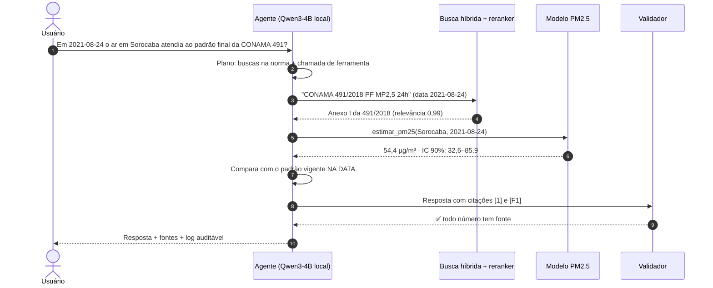

**Resposta real registrada no log** (`logs/agent_runs.jsonl`):

> Em 2021-08-24, a concentração estimada de PM2,5 em Sorocaba foi de **54,4 µg/m³ (intervalo de 90%: 32,6–85,9)**. Na data, o padrão vigente para MP2,5 de 24 horas era o PI-1 de 60 µg/m³, conforme a Resolução CONAMA 491/2018, Anexo I [1]. A estimativa não ultrapassou o PI-1, mas ultrapassou os padrões PI-2 (50), PI-3 (37) e PF (25 µg/m³) [F1]. Como o padrão final (PF) foi ultrapassado, **a qualidade do ar não atendeu ao padrão final** da Resolução CONAMA 491/2018 na data referida.
>
> *Fontes: [1] Resolução CONAMA 491/2018, Anexo I (MP2,5, 24 horas)*

### O que torna o agente confiável

- **Chunking que respeita a estrutura jurídica:** capítulo → artigo → parágrafo → inciso → alínea → anexo. Tabelas viram linhas com o nome da coluna junto a cada valor, para o LLM não confundir PI-1, PI-2 e PF
- **Vigência temporal:** a CONAMA 506/2024 revogou partes da 491/2018. O agente aplica o padrão **vigente na data perguntada**, calculado em código (ferramenta `padrao_mp25_vigente`), não pela "memória" do LLM
- **Recuperação híbrida:** BM25 + embeddings multilíngues (Granite-278M) fundidos por RRF, e um reranker (Qwen3-0.6B) que também decide quando **recusar**
- **Validação pós-geração:** números sem fonte nos trechos citados ou na saída da ferramenta bloqueiam a resposta
- **100% local:** modelos GGUF via `llama.cpp` em CPU, custo de API zero. Também funciona com Ollama ou qualquer API compatível com OpenAI
- **Auditável:** cada execução registra pergunta, trechos recuperados, chamadas de ferramenta, resposta, tokens e tempo

### 📊 Avaliação

Conjunto de **36 perguntas escritas à mão** e conferidas contra o texto das normas: fatos, composição de vários trechos, vigência temporal, uso de ferramenta e perguntas **sem resposta na base** (que devem ser recusadas).

| Métrica | Qwen3-4B (escolhido) | Gemma3-4B |
|---|:---:|:---:|
| Acerto nas perguntas respondíveis | **93%** | 70% |
| Recusa correta (fora da base) | **100%** | 100% |
| Recusa indevida | **3%** | 17% |
| Precisão das citações (dispositivo exato) | **81%** | 59% |
| Fidelidade às fontes (LLM-juiz) | **100%** | 64% |
| Uso correto da ferramenta de PM2.5 | **100%** | 0% |

| Recuperação (30 perguntas com trecho-ouro) | recall@1 | recall@5 | MRR |
|---|:---:|:---:|:---:|
| BM25 | 0,62 | 0,92 | 0,80 |
| Embeddings (Granite-278M) | 0,58 | 0,90 | 0,76 |
| **Híbrido RRF (BM25 + Granite)** | **0,72** | **0,98** | **0,86** |

---

## 🚀 Como rodar

**Requisitos:** Python 3.12 ou 3.13, CPU x86-64 (sem GPU), ~16 GB de RAM recomendados. A amostra de dados versionada tem ~12 MB; os modelos GGUF somam ~4,3 GB.

```bash
git clone https://github.com/LucasBetioli123/respira-sp.git
cd respira-sp
make setup      # cria .venv e instala dependências com versões fixas
make models     # baixa os modelos GGUF (LLM, embeddings, reranker)
cp .env.example .env
```

**Demo rápida do Módulo 1** (treina, calibra, faz uma previsão e um mapa, em ~3 min):

```bash
.venv/bin/python -m src.aq.pipeline --quick
```

**Estimativa pontual e API:**

```bash
make predict LAT=-23.50 LON=-47.45 DATE=2021-08-23 H=1   # previsão D+1 para Sorocaba
make api                                                 # GET /predict?municipio=Sorocaba&date=2021-08-23&horizon=1
```

**Perguntar ao agente** (CLI ou chat web em http://localhost:7860):

```bash
make ask Q="Em 2021-08-24 a qualidade do ar em Sorocaba atendia ao padrão final (PF) de MP2,5 de 24 horas da CONAMA 491/2018?"
make chat
```

<details>
<summary><b>Windows (PowerShell, sem make)</b></summary>

```powershell
python -m venv .venv
.venv\Scripts\python -m pip install -r requirements.txt
.venv\Scripts\python -m pip install -r requirements-llm.txt --only-binary=:all: --extra-index-url https://abetlen.github.io/llama-cpp-python/whl/cpu
.venv\Scripts\python -m pip install -r requirements-nn.txt
Copy-Item .env.example .env
.venv\Scripts\python -m src.rag.models_dl
.venv\Scripts\python -m src.aq.pipeline --quick
.venv\Scripts\python -m src.rag.cli "Quais são os padrões de MP2,5 da CONAMA 491/2018?"
```
</details>

<details>
<summary><b>Todos os comandos</b></summary>

| Operação | Comando | Tempo aproximado |
|---|---|---|
| Pipeline completo do Módulo 1 sobre a amostra | `make all-sample` | 30–60 min |
| Refazer do zero, baixando todos os dados brutos | `python -m src.aq.pipeline --full` | horas |
| Benchmark de recuperação | `make rag-bench` | ~1 h 20 em CPU |
| Avaliação completa do agente | `make rag-eval` | ~3 h em CPU |
| Avaliação com LLM-juiz | `python -m eval.run_rag_eval --judge models/llm/gemma3-4b-it-q4_k_m.gguf --tag com-juiz` | mais que a anterior |
| Testes | `make test` | ~20 s |
| Notebooks com saída | `make notebooks` | alguns minutos |
| Regenerar a documentação técnica | `python -m scripts.build_report` | segundos |
| Regenerar os dados do dashboard | `python -m scripts.build_showcase` | segundos |
| Validar uma instalação | `python -m scripts.verify_install` | ~1 min |

`horizon=1` retorna a previsão para `date + 1`. Os dados cobrem **jan/2021 a abr/2023** (demonstração histórica, sem feed em tempo real). No agente, "hoje/amanhã" usam a data de referência fixada por `AGENT_TODAY`.

**LLM configurável** (`.env`): `LLM_PROVIDER=llamacpp` (padrão, local), `ollama` ou `openai_compat`. `RAG_MODE`: `bm25`, `dense`, `hybrid` ou `hybrid_rerank` (padrão).
</details>

### 🐳 Docker

```bash
docker build -t respira-sp .
docker run --rm respira-sp python -m pytest -q
docker run --rm -v "$PWD/models:/app/models" respira-sp python -m src.aq.pipeline --quick
docker run --rm -p 7860:7860 -v "$PWD/models:/app/models" respira-sp make chat
```

---

## 🗂️ Estrutura

```
src/aq/data/     coletores: leitura parcial por HTTP range de NetCDF/HDF5 e COG (sem baixar arquivos inteiros)
src/aq/          variáveis, validação espaço-temporal, modelos, CQR, mapas, CLI e API FastAPI
src/rag/         parser jurídico, chunking, busca híbrida, reranker, LLM, ferramentas, agente, chat
eval/            36 perguntas com gabarito + avaliação de recuperação e ponta a ponta
reports/         métricas (CSV) e figuras geradas pelo código
notebooks/       exploração de dados, modelagem e RAG, com saídas executadas
docs/            dashboard interativo (GitHub Pages) e detalhes técnicos
tests/           29 testes: causalidade, chunker, agente, avaliação, configuração
```

## 🧰 Stack

**ML e dados:** LightGBM · XGBoost · scikit-learn · PyTorch · SHAP · PyKrige · xarray · rasterio · GeoPandas · pandas
**IA generativa:** llama.cpp · Qwen3-4B · Granite Embedding 278M · Qwen3 Reranker 0.6B · BM25 · RRF
**Engenharia:** FastAPI · Docker · Makefile · pytest · Jupyter · Plotly
**Fontes:** CETESB (via OpenAQ) · NOAA GOES-16 · ESA Sentinel-5P · ECMWF ERA5 · ESA WorldCover · Copernicus DEM · IBGE

## 🔭 Limitações e próximos passos

- Dados de 2021 a 2023, sem feed em tempo real. A reanálise ERA5 tem latência que não é simulada; o próximo passo é usar meteorologia disponível no horário de emissão
- Poucos dias muito poluídos no histórico: a cobertura do intervalo cai acima de 50 µg/m³
- As faixas do IQAr seguem a CONAMA 491/2018 (correto para o período); datas após julho de 2024 precisariam da regra da 506/2024
- A base do agente cobre 7 normas federais, não toda a legislação estadual
- Próximos: mais estações e anos, limiar de alerta calibrado fora do teste, previsão numérica do tempo e um conjunto de avaliação do RAG maior e independente

---

<div align="center">

Feito por **[Lucas Betioli](https://github.com/LucasBetioli123)** · Se este projeto foi útil ou interessante, deixe uma ⭐

</div>
