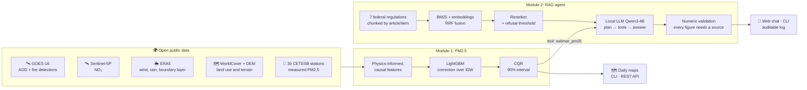
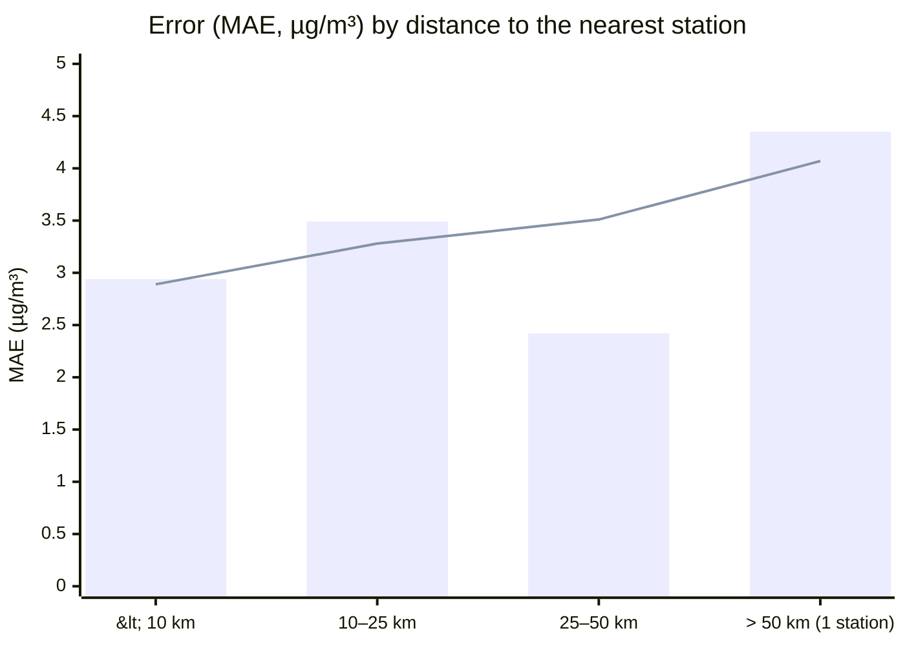
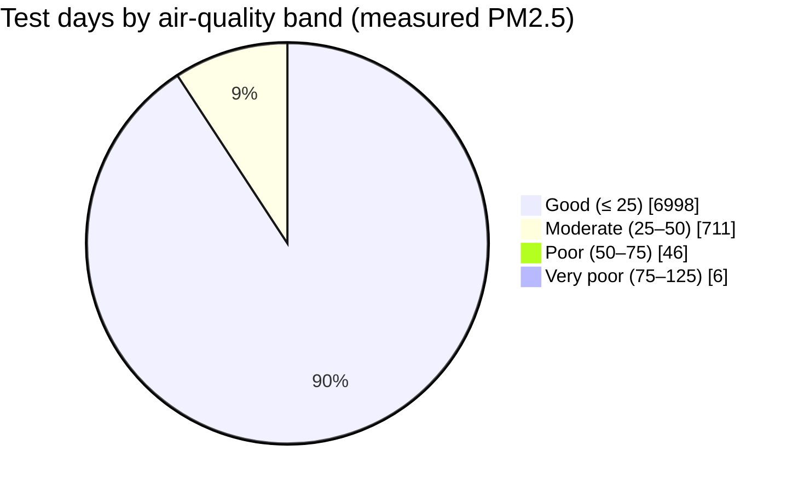
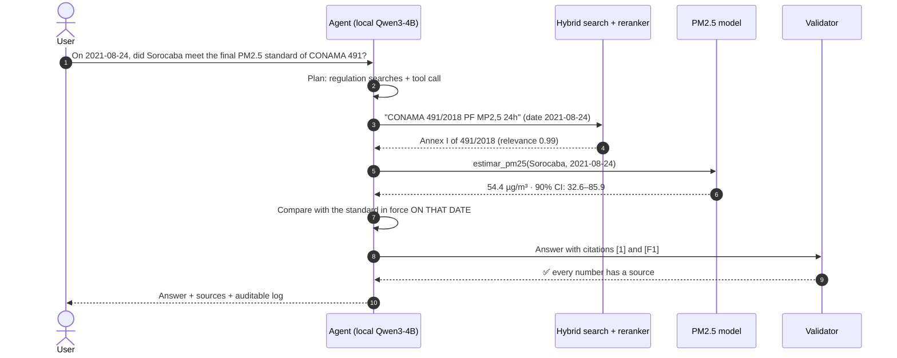

<div align="center">

# 🌬️ AirIQ SP

### AI for air quality: satellite data, machine learning and an agent that understands environmental law

[](#-quickstart)
[](#%EF%B8%8F-module-1--pm25-where-there-is-no-sensor)
[](#-module-2--environmental-law-agent)
[-1baf7a)](#-module-2--environmental-law-agent)
[](tests/)
[](#-docker)

**🇺🇸 English** · [🇧🇷 Português](README.pt-BR.md)

**[📊 Open the interactive dashboard](https://lucasbetioli123.github.io/AirIQ-SP/)** · **[🤖 Ask the agent](https://lucasbetioli123.github.io/AirIQ-SP/#agent)** · **[🔬 Technical deep dive](docs/TECHNICAL_DETAILS.md)** · **[📓 Notebooks](notebooks/)**

<a href="https://lucasbetioli123.github.io/AirIQ-SP/"></a>

</div>

---

## 💡 The idea in 30 seconds

> **Why AirIQ?** *IQ* as in intelligence, and as in **IQAr**, Brazil's official Air Quality Index.

**PM2.5** (fine particles under 2.5 µm) is the air pollutant most strongly linked to respiratory and cardiovascular disease. Yet the state of São Paulo, Brazil, with **645 municipalities**, has only a few dozen stations measuring PM2.5, almost all of them clustered around the São Paulo metro area. **For most of the state, there is simply no measurement.**

AirIQ SP tackles this on two fronts:

| | Module | Question it answers |
|---|---|---|
| 🛰️ | **PM2.5 estimation & forecasting** | *"What is the PM2.5 today (and tomorrow) anywhere in the state, and how sure are we?"* |
| 🤖 | **Environmental-law RAG agent** | *"Does that value break the legal standard in force on that date? Which article says so?"* |

The two are connected: the agent **calls the PM2.5 model as a tool**, retrieves the exact passage of the CONAMA resolution (Brazil's national environmental council), compares the value with the standard in force on that date and **cites every number**. If the answer is not in its knowledge base, it **refuses** instead of making something up.

## 🧭 Architecture



---

## 🛰️ Module 1 · PM2.5 where there is no sensor

**How it works:** spatial interpolation between stations (IDW) is already a strong baseline, so the model does not predict PM2.5 from scratch. It learns a **local correction** on top of IDW (`log(PM2.5) − log(IDW)`) from physical signals:

- **AOD / boundary-layer height:** links aerosol in the atmospheric column to concentration at ground level
- **Hygroscopic correction** `AOD × (1−RH)^0.6`: particles swell with humidity and fool the satellite
- **Upwind fire:** fire detections within 150/400 km, weighted by wind direction and fire radiative power (FRP)
- **Ventilation** (boundary layer × wind speed), rain, NO₂, urbanization, vegetation and terrain

### ✅ Validated the hard way

Random validation inflates the scores (here, R² 0.84 vs. 0.73 under honest validation). So:

- **Unseen stations:** each group of stations is held out of training *and* out of the IDW references during its test
- **Later period:** train on the past, test on the future (two temporal folds, including the 2021 dry/smoke season)
- **No future leakage:** the next-day forecast only uses data available at the end of day D. An automated test deletes every future observation and checks that the features do not change

### 📈 Results

| Metric | Result |
|---|---|
| Mean absolute error (MAE) on never-seen stations | **2.98 µg/m³** (R² 0.73) |
| Error reduction vs. IDW at **25–50 km** from stations | **−31%** (3.51 → 2.42 µg/m³) |
| Real coverage of the 90% interval (CQR) | **90.6%** |
| Next-day forecast vs. persistence ("tomorrow = today") | **−6%** error with a station · **−9%** without one |
| Polluted-day detection (> 25 µg/m³) using the interval's upper bound as alert | **94%** |

The gain shows up exactly where a map is useful, **far from the stations**:


<sub>Bars = LightGBM with satellite data · line = IDW (classic interpolation). Near stations IDW is hard to beat; at 25–50 km the model makes 31% less error.</sub>

<details>
<summary><b>🔍 An honest look: where the model still fails</b></summary>

<br>

90% of test days fall in the "Good" air-quality band, so always predicting "Good" already scores 90%. That is why the evaluation also reports balanced accuracy and polluted-day detection.



Tree models **smooth out peaks**: on its own, the point estimate catches 62% of days above 25 µg/m³, versus 79% for IDW. The fix was to use the uncertainty: alerting on the **upper bound of the 90% interval**, with a fixed rule and no tuning on the test set, catches **94%** of those days. The interval carries the risk signal that the point estimate loses.

Every number lives in [`docs/TECHNICAL_DETAILS.md`](docs/TECHNICAL_DETAILS.md) and is generated from the CSVs in `reports/metrics/`.
</details>

### 🗺️ Estimate + uncertainty maps

Wildfire-smoke day (2021-08-24), forecast issued the day before. On the right, the width of the interval: uncertainty grows far from stations and during smoke episodes.


<details>
<summary><b>🖼️ More figures (benchmark, SHAP, intervals, episodes)</b></summary>

| | |
|---|---|
|  |  |
| **Benchmark of 25 models**: baselines, trees, neural nets, kriging | **SHAP**: what drives the correction over IDW |
|  |  |
| **Intervals**: raw quantiles × CQR × conformal | **Smoke episodes**: where the model fails and why |
|  |  |
| **Next-day forecast** × persistence | **Scatter**: IDW × model |

</details>

### 📍 The 30 reference stations (interactive map)

GitHub renders the map below as a navigable map: click a station to see its mean, maximum and share of days above 25 µg/m³. Orange = mean ≥ 15 µg/m³.

```geojson
{"type":"FeatureCollection","features":[
{"type":"Feature","geometry":{"type":"Point","coordinates":[-46.7921,-23.5267]},"properties":{"station":"Osasco","days measured":410,"mean PM2.5 (µg/m³)":19.0,"daily max (µg/m³)":101.4,"days above 25 µg/m³":"18%","marker-color":"#d95926","marker-size":"medium"}},
{"type":"Feature","geometry":{"type":"Point","coordinates":[-47.5363,-22.46]},"properties":{"station":"Santa Gertrudes","days measured":346,"mean PM2.5 (µg/m³)":17.2,"daily max (µg/m³)":66.6,"days above 25 µg/m³":"18%","marker-color":"#d95926","marker-size":"medium"}},
{"type":"Feature","geometry":{"type":"Point","coordinates":[-46.7433,-23.5187]},"properties":{"station":"Marg.Tietê-Pte Remédios","days measured":512,"mean PM2.5 (µg/m³)":16.8,"daily max (µg/m³)":80.4,"days above 25 µg/m³":"12%","marker-color":"#d95926","marker-size":"medium"}},
{"type":"Feature","geometry":{"type":"Point","coordinates":[-46.702,-23.5615]},"properties":{"station":"Pinheiros","days measured":266,"mean PM2.5 (µg/m³)":15.5,"daily max (µg/m³)":59.4,"days above 25 µg/m³":"15%","marker-color":"#d95926","marker-size":"medium"}},
{"type":"Feature","geometry":{"type":"Point","coordinates":[-46.6607,-23.5918]},"properties":{"station":"Ibirapuera","days measured":329,"mean PM2.5 (µg/m³)":15.4,"daily max (µg/m³)":56.3,"days above 25 µg/m³":"14%","marker-color":"#d95926","marker-size":"medium"}},
{"type":"Feature","geometry":{"type":"Point","coordinates":[-46.6635,-23.6163]},"properties":{"station":"Congonhas","days measured":432,"mean PM2.5 (µg/m³)":15.1,"daily max (µg/m³)":44.1,"days above 25 µg/m³":"8%","marker-color":"#d95926","marker-size":"small"}},
{"type":"Feature","geometry":{"type":"Point","coordinates":[-46.629,-23.506]},"properties":{"station":"Santana","days measured":389,"mean PM2.5 (µg/m³)":14.6,"daily max (µg/m³)":51.7,"days above 25 µg/m³":"11%","marker-color":"#2a78d6","marker-size":"medium"}},
{"type":"Feature","geometry":{"type":"Point","coordinates":[-46.6277,-23.5448]},"properties":{"station":"Parque D.Pedro II","days measured":432,"mean PM2.5 (µg/m³)":14.5,"daily max (µg/m³)":51.6,"days above 25 µg/m³":"10%","marker-color":"#2a78d6","marker-size":"small"}},
{"type":"Feature","geometry":{"type":"Point","coordinates":[-47.139,-22.7802]},"properties":{"station":"Paulínia-Sta Terezinha","days measured":276,"mean PM2.5 (µg/m³)":14.4,"daily max (µg/m³)":61.2,"days above 25 µg/m³":"9%","marker-color":"#2a78d6","marker-size":"small"}},
{"type":"Feature","geometry":{"type":"Point","coordinates":[-46.5185,-23.4555]},"properties":{"station":"Guarulhos-Paço Municipal","days measured":405,"mean PM2.5 (µg/m³)":14.2,"daily max (µg/m³)":44.5,"days above 25 µg/m³":"8%","marker-color":"#2a78d6","marker-size":"small"}},
{"type":"Feature","geometry":{"type":"Point","coordinates":[-46.4207,-23.5015]},"properties":{"station":"Itaim Paulista","days measured":517,"mean PM2.5 (µg/m³)":14.0,"daily max (µg/m³)":55.1,"days above 25 µg/m³":"10%","marker-color":"#2a78d6","marker-size":"medium"}},
{"type":"Feature","geometry":{"type":"Point","coordinates":[-47.1193,-22.9467]},"properties":{"station":"Campinas-V.União","days measured":352,"mean PM2.5 (µg/m³)":13.8,"daily max (µg/m³)":49.2,"days above 25 µg/m³":"8%","marker-color":"#2a78d6","marker-size":"small"}},
{"type":"Feature","geometry":{"type":"Point","coordinates":[-46.7561,-23.4132]},"properties":{"station":"Perus","days measured":270,"mean PM2.5 (µg/m³)":13.8,"daily max (µg/m³)":41.2,"days above 25 µg/m³":"7%","marker-color":"#2a78d6","marker-size":"small"}},
{"type":"Feature","geometry":{"type":"Point","coordinates":[-46.4099,-23.4401]},"properties":{"station":"Guarulhos-Pimentas","days measured":430,"mean PM2.5 (µg/m³)":13.8,"daily max (µg/m³)":66.8,"days above 25 µg/m³":"10%","marker-color":"#2a78d6","marker-size":"medium"}},
{"type":"Feature","geometry":{"type":"Point","coordinates":[-46.5564,-23.6184]},"properties":{"station":"São Caetano do Sul","days measured":409,"mean PM2.5 (µg/m³)":13.7,"daily max (µg/m³)":44.6,"days above 25 µg/m³":"9%","marker-color":"#2a78d6","marker-size":"small"}},
{"type":"Feature","geometry":{"type":"Point","coordinates":[-47.5815,-22.439]},"properties":{"station":"Rio Claro-Jd.Guanabara","days measured":355,"mean PM2.5 (µg/m³)":13.5,"daily max (µg/m³)":53.5,"days above 25 µg/m³":"10%","marker-color":"#2a78d6","marker-size":"medium"}},
{"type":"Feature","geometry":{"type":"Point","coordinates":[-46.6004,-23.5497]},"properties":{"station":"Mooca","days measured":349,"mean PM2.5 (µg/m³)":13.4,"daily max (µg/m³)":44.7,"days above 25 µg/m³":"7%","marker-color":"#2a78d6","marker-size":"small"}},
{"type":"Feature","geometry":{"type":"Point","coordinates":[-49.3983,-20.7847]},"properties":{"station":"São José do Rio Preto","days measured":301,"mean PM2.5 (µg/m³)":13.4,"daily max (µg/m³)":91.9,"days above 25 µg/m³":"9%","marker-color":"#2a78d6","marker-size":"small"}},
{"type":"Feature","geometry":{"type":"Point","coordinates":[-46.5462,-23.6987]},"properties":{"station":"S.Bernardo-Centro","days measured":419,"mean PM2.5 (µg/m³)":12.9,"daily max (µg/m³)":40.8,"days above 25 µg/m³":"7%","marker-color":"#2a78d6","marker-size":"small"}},
{"type":"Feature","geometry":{"type":"Point","coordinates":[-46.697,-23.7763]},"properties":{"station":"Grajaú-Parelheiros","days measured":400,"mean PM2.5 (µg/m³)":12.8,"daily max (µg/m³)":55.9,"days above 25 µg/m³":"10%","marker-color":"#2a78d6","marker-size":"medium"}},
{"type":"Feature","geometry":{"type":"Point","coordinates":[-46.7374,-23.5663]},"properties":{"station":"Cid.Universitária-USP-Ipen","days measured":384,"mean PM2.5 (µg/m³)":12.5,"daily max (µg/m³)":62.2,"days above 25 µg/m³":"7%","marker-color":"#2a78d6","marker-size":"small"}},
{"type":"Feature","geometry":{"type":"Point","coordinates":[-46.466,-23.6685]},"properties":{"station":"Mauá","days measured":377,"mean PM2.5 (µg/m³)":12.5,"daily max (µg/m³)":49.3,"days above 25 µg/m³":"7%","marker-color":"#2a78d6","marker-size":"small"}},
{"type":"Feature","geometry":{"type":"Point","coordinates":[-47.6497,-22.7012]},"properties":{"station":"Piracicaba","days measured":381,"mean PM2.5 (µg/m³)":11.9,"daily max (µg/m³)":57.9,"days above 25 µg/m³":"7%","marker-color":"#2a78d6","marker-size":"small"}},
{"type":"Feature","geometry":{"type":"Point","coordinates":[-46.8971,-23.192]},"properties":{"station":"Jundiaí","days measured":582,"mean PM2.5 (µg/m³)":11.7,"daily max (µg/m³)":53.9,"days above 25 µg/m³":"5%","marker-color":"#2a78d6","marker-size":"small"}},
{"type":"Feature","geometry":{"type":"Point","coordinates":[-45.1911,-22.8019]},"properties":{"station":"Guaratinguetá","days measured":446,"mean PM2.5 (µg/m³)":11.4,"daily max (µg/m³)":35.4,"days above 25 µg/m³":"3%","marker-color":"#2a78d6","marker-size":"small"}},
{"type":"Feature","geometry":{"type":"Point","coordinates":[-46.3005,-23.9813]},"properties":{"station":"Santos-Ponta da Praia","days measured":414,"mean PM2.5 (µg/m³)":10.8,"daily max (µg/m³)":30.4,"days above 25 µg/m³":"2%","marker-color":"#2a78d6","marker-size":"small"}},
{"type":"Feature","geometry":{"type":"Point","coordinates":[-47.4143,-22.5636]},"properties":{"station":"Limeira","days measured":360,"mean PM2.5 (µg/m³)":10.7,"daily max (µg/m³)":43.0,"days above 25 µg/m³":"3%","marker-color":"#2a78d6","marker-size":"small"}},
{"type":"Feature","geometry":{"type":"Point","coordinates":[-45.5758,-23.0324]},"properties":{"station":"Taubaté","days measured":407,"mean PM2.5 (µg/m³)":10.2,"daily max (µg/m³)":32.4,"days above 25 µg/m³":"2%","marker-color":"#2a78d6","marker-size":"small"}},
{"type":"Feature","geometry":{"type":"Point","coordinates":[-46.7661,-23.4563]},"properties":{"station":"Pico do Jaraguá","days measured":378,"mean PM2.5 (µg/m³)":10.1,"daily max (µg/m³)":35.7,"days above 25 µg/m³":"3%","marker-color":"#2a78d6","marker-size":"small"}},
{"type":"Feature","geometry":{"type":"Point","coordinates":[-45.8908,-23.2236]},"properties":{"station":"S.José Campos-Jd.Satelite","days measured":215,"mean PM2.5 (µg/m³)":7.9,"daily max (µg/m³)":23.1,"days above 25 µg/m³":"0%","marker-color":"#2a78d6","marker-size":"small"}}
]}
```

---

## 🤖 Module 2 · Environmental-law agent

An assistant that answers questions about Brazilian air-quality regulations **citing the exact article**, and knows when to call the PM2.5 model because the question involves a place and a date.

> [!NOTE]
> 🇧🇷 **The regulations are in Portuguese (pt-BR) because they are Brazil's own laws** (CONAMA resolutions and federal acts). The knowledge base, the questions and the agent's answers are therefore in Portuguese, while the code and documentation are in English. Retrieval and generation over real Portuguese legal text is part of what this module demonstrates.

**▶ [Try it in the dashboard](https://lucasbetioli123.github.io/AirIQ-SP/#agent):** pick one of the 36 evaluation questions and watch a replay of the real recorded run: planning, regulation search, PM2.5 tool call, streamed answer, validation and the cited legal passages.



**Real answer from the log** (`logs/agent_runs.jsonl`), in Portuguese with an English translation:

> 🇧🇷 *"Em 2021-08-24, a concentração estimada de PM2,5 em Sorocaba foi de **54,4 µg/m³ (intervalo de 90%: 32,6–85,9)**. Na data, o padrão vigente para MP2,5 de 24 horas era o PI-1 de 60 µg/m³, conforme a Resolução CONAMA 491/2018, Anexo I [1]. A estimativa não ultrapassou o PI-1, mas ultrapassou os padrões PI-2 (50), PI-3 (37) e PF (25 µg/m³) [F1]. Como o padrão final (PF) foi ultrapassado, **a qualidade do ar não atendeu ao padrão final** da Resolução CONAMA 491/2018 na data referida."*
>
> 🇺🇸 On 2021-08-24, the estimated PM2.5 in Sorocaba was **54.4 µg/m³ (90% interval: 32.6–85.9)**. On that date, the 24-hour standard in force was interim target PI-1 of 60 µg/m³, per CONAMA Resolution 491/2018, Annex I [1]. The estimate did not exceed PI-1, but exceeded PI-2 (50), PI-3 (37) and the final standard PF (25 µg/m³) [F1]. Since the final standard was exceeded, **air quality did not meet the final standard** of Resolution 491/2018 on that date.
>
> *Sources: [1] CONAMA Resolution 491/2018, Annex I (PM2.5, 24 hours)*

### What makes the agent trustworthy

- **Chunking that respects legal structure:** chapter → article → paragraph → item → sub-item → annex. Tables become rows with the column name next to each value, so the LLM never mixes up interim targets PI-1, PI-2 and the final standard
- **Temporal validity:** CONAMA 506/2024 partially repealed 491/2018. The agent applies the standard **in force on the date asked**, computed in code (`padrao_mp25_vigente` tool), not from the LLM's "memory"
- **Hybrid retrieval:** BM25 + multilingual embeddings (Granite-278M) fused with Reciprocal Rank Fusion, plus a reranker (Qwen3-0.6B) that also decides when to **refuse**
- **Post-generation validation:** any number without support in the cited passages or tool output blocks the answer
- **100% local:** GGUF models via `llama.cpp` on CPU, zero API cost. Also works with Ollama or any OpenAI-compatible API
- **Auditable:** each run logs the question, retrieved passages, tool calls, answer, tokens and latency

### 📊 Evaluation

A set of **36 hand-written questions**, checked against the text of the regulations: facts, multi-passage composition, temporal validity, tool use and questions **with no answer in the base** (which must be refused).

| Metric | Qwen3-4B (chosen) | Gemma3-4B |
|---|:---:|:---:|
| Accuracy on answerable questions | **93%** | 70% |
| Correct refusal (out of scope) | **100%** | 100% |
| Wrongful refusal | **3%** | 17% |
| Citation precision (exact legal provision) | **81%** | 59% |
| Faithfulness to sources (LLM-as-judge) | **100%** | 64% |
| Correct use of the PM2.5 tool | **100%** | 0% |

| Retrieval (30 questions with a gold passage) | recall@1 | recall@5 | MRR |
|---|:---:|:---:|:---:|
| BM25 | 0.62 | 0.92 | 0.80 |
| Embeddings (Granite-278M) | 0.58 | 0.90 | 0.76 |
| **Hybrid RRF (BM25 + Granite)** | **0.72** | **0.98** | **0.86** |

---

## 🚀 Quickstart

**Requirements:** Python 3.12 or 3.13, x86-64 CPU (no GPU), ~16 GB RAM recommended. The versioned data sample is ~12 MB; the GGUF models add up to ~4.3 GB.

```bash
git clone https://github.com/LucasBetioli123/AirIQ-SP.git
cd AirIQ-SP
make setup      # creates .venv and installs pinned dependencies
make models     # downloads the GGUF models (LLM, embeddings, reranker)
cp .env.example .env
```

**Module 1 quick demo** (trains, calibrates, forecasts and draws a map in ~3 min):

```bash
.venv/bin/python -m src.aq.pipeline --quick
```

**Point estimate and API:**

```bash
make predict LAT=-23.50 LON=-47.45 DATE=2021-08-23 H=1   # next-day forecast for Sorocaba
make api                                                 # GET /predict?municipio=Sorocaba&date=2021-08-23&horizon=1
```

**Ask the agent** (CLI, or web chat at http://localhost:7860):

```bash
make ask Q="Em 2021-08-24 a qualidade do ar em Sorocaba atendia ao padrão final (PF) de MP2,5 de 24 horas da CONAMA 491/2018?"
make chat
```

<details>
<summary><b>Windows (PowerShell, no make)</b></summary>

```powershell
python -m venv .venv
.venv\Scripts\python -m pip install -r requirements.txt
.venv\Scripts\python -m pip install -r requirements-llm.txt --only-binary=:all: --extra-index-url https://abetlen.github.io/llama-cpp-python/whl/cpu
.venv\Scripts\python -m pip install -r requirements-nn.txt
Copy-Item .env.example .env
.venv\Scripts\python -m src.rag.models_dl
.venv\Scripts\python -m src.aq.pipeline --quick
.venv\Scripts\python -m src.rag.cli "Quais são os padrões de MP2,5 da CONAMA 491/2018?"
```
</details>

<details>
<summary><b>All commands</b></summary>

| Task | Command | Approx. time |
|---|---|---|
| Full Module 1 pipeline on the sample | `make all-sample` | 30–60 min |
| Rebuild from scratch, downloading all raw data | `python -m src.aq.pipeline --full` | hours |
| Retrieval benchmark | `make rag-bench` | ~1 h 20 on CPU |
| Full agent evaluation | `make rag-eval` | ~3 h on CPU |
| Evaluation with LLM-as-judge | `python -m eval.run_rag_eval --judge models/llm/gemma3-4b-it-q4_k_m.gguf --tag with-judge` | longer than the above |
| Tests | `make test` | ~20 s |
| Notebooks with outputs | `make notebooks` | a few minutes |
| Regenerate the technical report | `python -m scripts.build_report` | seconds |
| Regenerate the dashboard data | `python -m scripts.build_showcase` | seconds |
| Validate an installation | `python -m scripts.verify_install` | ~1 min |

`horizon=1` returns the forecast for `date + 1`. Data cover **Jan 2021 to Apr 2023** (historical demo, no real-time feed). In the agent, "today/tomorrow" use the reference date set by `AGENT_TODAY`.

**Configurable LLM** (`.env`): `LLM_PROVIDER=llamacpp` (default, local), `ollama` or `openai_compat`. `RAG_MODE`: `bm25`, `dense`, `hybrid` or `hybrid_rerank` (default).
</details>

### 🐳 Docker

```bash
docker build -t airiq-sp .
docker run --rm airiq-sp python -m pytest -q
docker run --rm -v "$PWD/models:/app/models" airiq-sp python -m src.aq.pipeline --quick
docker run --rm -p 7860:7860 -v "$PWD/models:/app/models" airiq-sp make chat
```

---

## 🗂️ Project layout

```
src/aq/data/     collectors: partial HTTP-range reads of NetCDF/HDF5 and COG (no full-file downloads)
src/aq/          features, spatio-temporal validation, models, CQR, maps, CLI and FastAPI API
src/rag/         legal-text parser, chunking, hybrid search, reranker, LLM, tools, agent, chat
eval/            36 questions with answer keys + retrieval and end-to-end evaluation
reports/         metrics (CSV) and figures generated by the code
notebooks/       data exploration, modeling and RAG, with executed outputs
docs/            interactive dashboard (GitHub Pages) and technical deep dive
tests/           29 tests: causality, chunker, agent, evaluation, configuration
```

Code, comments and docs are in English. Data keys (CSV columns, JSON fields, log records), LLM prompts and the legal text stay in Portuguese, as they belong to the Brazilian-law domain.

## 🧰 Tech stack

**ML & data:** LightGBM · XGBoost · scikit-learn · PyTorch · SHAP · PyKrige · xarray · rasterio · GeoPandas · pandas
**Generative AI:** llama.cpp · Qwen3-4B · Granite Embedding 278M · Qwen3 Reranker 0.6B · BM25 · RRF
**Engineering:** FastAPI · Docker · Makefile · pytest · Jupyter · Plotly
**Data sources:** CETESB (via OpenAQ) · NOAA GOES-16 · ESA Sentinel-5P · ECMWF ERA5 · ESA WorldCover · Copernicus DEM · IBGE

## 🔭 Limitations & next steps

- Data from 2021 to 2023, no real-time feed. ERA5 reanalysis latency is not simulated; the next step is weather data available at issue time
- Few very polluted days in the history: interval coverage drops above 50 µg/m³
- Air-quality bands follow CONAMA 491/2018 (correct for the period); dates after July 2024 would need the 506/2024 rule
- The agent's base covers 7 federal regulations, not all state legislation
- Next: more stations and years, an alert threshold calibrated outside the test set, numerical weather prediction, and a larger independent RAG evaluation set

---

<div align="center">

Built by **[Lucas Betioli](https://github.com/LucasBetioli123)** · If you found this useful or interesting, leave a ⭐

</div>
